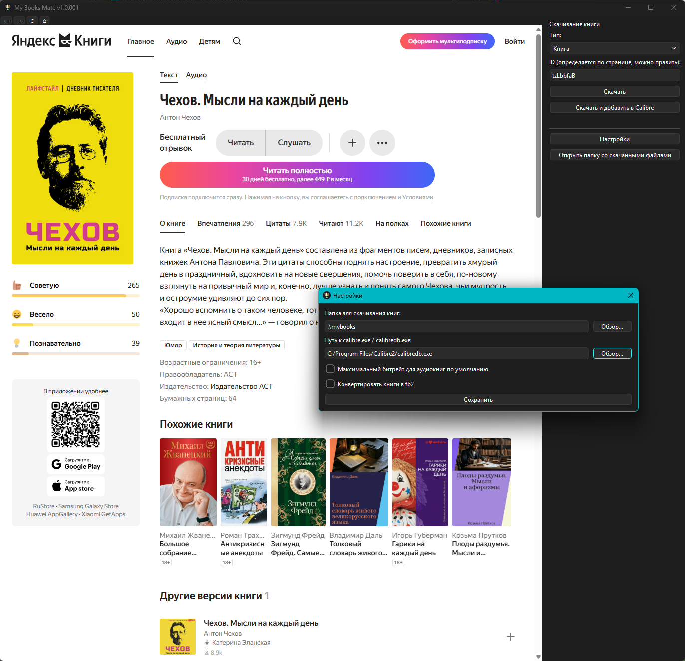
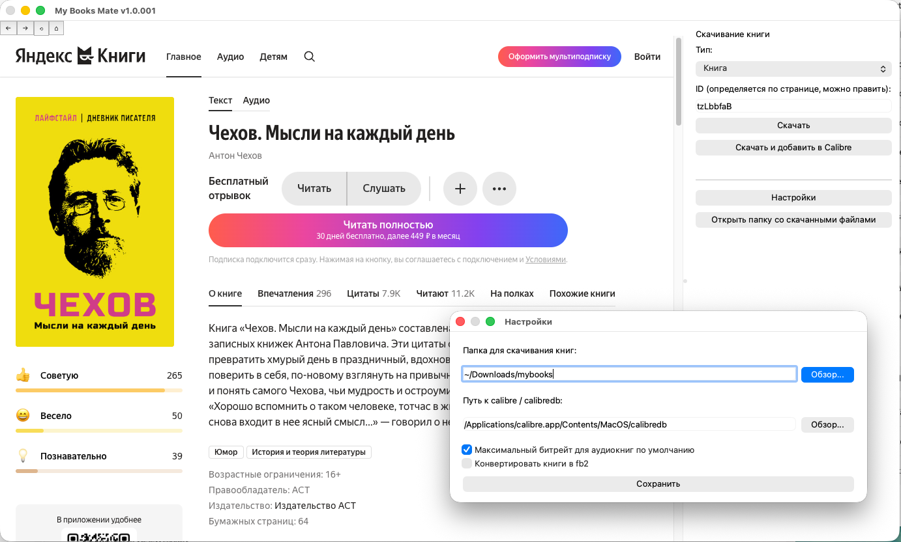
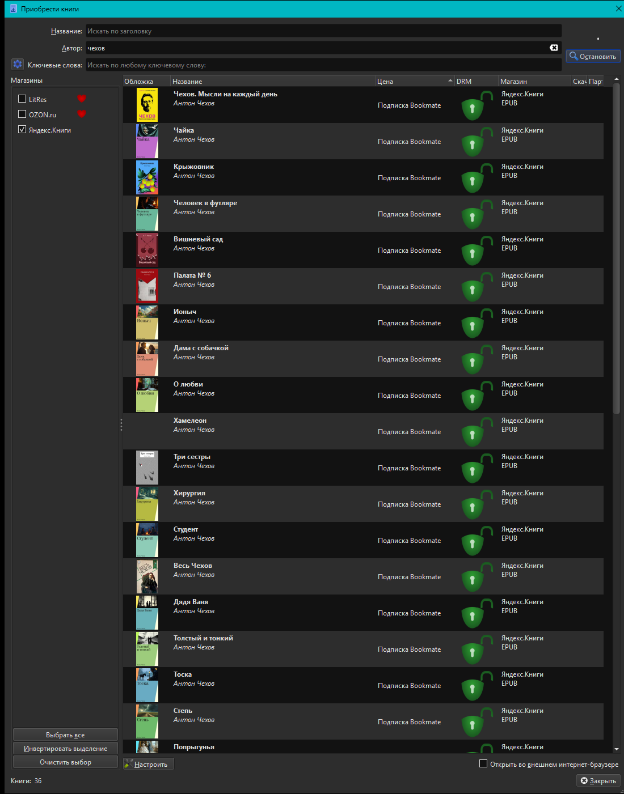

# My Books Mate

> Приложение со встроенным браузером для https://books.yandex.ru/.
> Позволяет авторизоваться в сервисе Яндекс.Книги (бывш. Bookmate), просматривать книги и скачивать их (с опциональным добавлением в Calibre) прямо со страницы книги.

Функциональность:
- встроенный браузер;
- авторизация в Bookmate API происходит автоматически при первом скачивании прямо со страницы встроенного браузера (отдельное окно OAuth Яндекс открывается по необходимости, использует тот же профиль браузера — авторизуется и сама страница books.yandex.ru);
- при открытии страницы книги/аудиокниги/комикса/сериала/серии её ID автоматически подставляется в панель скачивания; если открытая страница не соответствует ни одному из этих типов, поле ID очищается;
- в браузере доступны кнопки навигации (←, →, ⟲, ⌂) для быстрого перемещения по страницам и обновления; контекстное меню браузера дополнено пунктом "Копировать ссылку на страницу";
- кнопка **"Скачать"** скачивает книгу;
- кнопка **"Скачать и добавить в Calibre"** скачивает книгу и добавляет её в библиотеку Calibre через `calibredb` (поддерживается для книг, комиксов и сериалов). Авторам в Calibre выставляется корректное сортировочное имя ("Антон Чехов" → "Чехов, Антон", несколько авторов через " & "). Для книг и комиксов, если файл уже скачан ранее, перед скачиванием появляется диалог "Скачать заново" / "Пропустить";
- кнопка **"Выбрать книги..."** открывает диалог с чекбоксами по всем книгам/аудиокнигам/комиксам/сериалам/сериям текущей страницы (например, страницы автора, серии или раздела) — страница предварительно прокручивается (lazy-scroll), чтобы подгрузились все ссылки. Отмеченные книги скачиваются по очереди с индикацией прогресса, опционально с добавлением в Calibre;
- в настройках: папка для скачивания, путь к Calibre (выбирайте `calibre.exe` или `calibredb.exe`), а также опции максимального битрейта для аудиокниг и конвертировать ли книги в FB2 (по умолчанию сохраняются в EPUB).

### Данные авторизации и настроек

Приложение сохраняет локально следующие данные:
- папка **`webengine_profile/`** — кэш браузера и cookies, включая сессию books.yandex.ru
- файл **`token.txt`** — токен авторизации в Bookmate API (Яндекс.Книги)
- файл **`config.ini`** — папка скачивания, путь к Calibre, настройки конвертации

Местоположение этих файлов зависит от способа запуска:
- **Windows**: рядом с `MyBooksMate.exe` в той же папке
- **macOS**: `~/Library/Application Support/MyBooksMate/`
- **При запуске из исходников**: в корне проекта (там где находится `requirements.txt`)

> [!WARNING]
> Не распространяйте приложение вместе со своими настройками! Это доступ к вашему аккаунту в Яндексе!

### Скачивание

> Пользователь должен быть авторизован в сервисе Яндекс.Книги и иметь действующую подписку. При окончании подписки пользователь должен удалить скачанные из сервиса книги, поскольку это с окончанием подписки он теряет доступ к сервису.

Книги сохраняются файлом `Авторы - Название.<расширение>`. Подпапка создаётся только когда это неизбежно: для аудиокниг (главы), комиксов (временные изображения) и для сериалов/серий (контейнер для частей).

При скачивании книги (`book`/`serial`) теги (жанры), издательство и год издания подгружаются со страницы книги на books.yandex.ru (этих данные нет в Bookmate API) и встраиваются в метаданные EPUB (`dc:subject`, `dc:publisher`, `dc:date`). Calibre и другие читалки подхватят их автоматически. Обложка проверяется и принудительно восстанавливается в EPUB при отсутствии (см. `fix_epub_cover` в `mybooksmate/RUBookmatedownloader.py`) и повторно после встраивания метаданных, если пересборка архива её затронула.

## Готовые сборки

### Windows x64


- **`release-Win/`** — portable-сборка для Windows: `MyBooksMate.exe` (bootstrap-запускатор с иконкой из `favicon.ico`), встроенный Python (`python-embed/` без системного Python), исходники приложения и `config.ini`. Достаточно скопировать всю папку на нужный компьютер и запустить `MyBooksMate.exe` — при первом запуске сам поставит pip и нужные зависимости, Python уже внутри.

  Чтобы пересобрать `MyBooksMate.exe` (например, после изменения `mybooksmate/launcher.py`):
  
  ```bash
  python -m PyInstaller --onefile --noconsole --name "MyBooksMate" --icon "favicon.ico" --distpath ./release-Win --workpath ./build_tmp --specpath ./build_tmp mybooksmate/launcher.py
  ```

### MacOS arm64


- **`release-Mac/`** — сборка для macOS (Apple Silicon), полностью самодостаточная: папка содержит только `MyBooksMate.app`, сам `.app` можно перенести в `/Applications`. Требуется Python 3.10+ на Mac.
  
  MacOS может не запустить приложение из-за настроек безопасности, т.к. оно не подписано сертификатом разработчика. Блокировка снимается в *System Settings / Privace & Security / Security / Allow applications from AppStore & known developers / MyBooksMate: Allow* 

### Плагин для Calibre


- **`release-Calibre/`** — плагин-магазин для Calibre **"Яндекс.Книги"**: поиск книг на books.yandex.ru, авторизация в Bookmate (Яндекс.Книги) и скачивание прямо в библиотеку Calibre (диалог "Получить книги").
  Поддерживает только текстовые книги в EPUB. Для сборки и установки см. [release-Calibre/README.md](release-Calibre/README.md).


## GUI через Python:
```
pip install -r requirements.txt
python -m mybooksmate.main
```

## Консольная версия скрипта для скачнивания (mybooksmate/RUBookmatedownloader.py)
### Примеры запуска:

Для определения нужного флага смотрите на URL, в нем всегда есть подсказка: https://bookmate.ru/<флаг>/`<id>`/
1. Скачать аудиокнигу в максимальном качестве:\
`python mybooksmate/RUBookmatedownloader.py audiobook <id> --max_bitrate`
3. Скачать аудиокнигу в обычном качестве:\
`python mybooksmate/RUBookmatedownloader.py audiobook <id>`
4. Скачать текстовую книгу:\
`python mybooksmate/RUBookmatedownloader.py book <id>`
5. Скачать комикс:\
`python mybooksmate/RUBookmatedownloader.py comicbook <id>`
6. Скачать текстовую книгу, разбитую на несколько частей:\
`python mybooksmate/RUBookmatedownloader.py serial <id>`
5. Скачать серию текстовых книг, аудиокниг или комиксов:\
`python mybooksmate/RUBookmatedownloader.py series <id>`


Навайбкожено с Claude Code на основе [RU Bookmate Downloader](https://github.com/kettle017/RU_Bookmate_downloader) от @kettle017.

## Donate
[https://yoomoney.ru/to/4100135835863](https://yoomoney.ru/to/4100135835863)